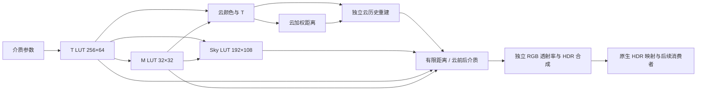

# P0 收口、Hillaire LUT、环境 Graph 与历史预算 · 2026-10-15

本轮按 `CCR_BORROW_PLAN_2026-10-14.md` 与进度核对继续实施，未改分支、未提交/推送。保留用户已确认的原天空修复作为 B2 对照；本轮新 LUT 画面有开发验证，尚未收到用户验收。不运行性能基准，也不报告未测得的 GPU 提速。

最终 SDK 已重建并核对源文件哈希。`CCR.min.js` SHA-256：`b3bcbe4a08b323e85197e19ed0f1c585bb0d81781a2b569e816568c4b8aeb6e6`；[本轮验证汇总](p1-verification-summary.json) 保存测试统计、实际资源预算与 SDK 身份。

## 1. 已接入的路径



- `AtmosphereLut143`：真实 WebGL2 全屏 fragment 生成 T/M/Sky；通过现有 RHI 创建永久纹理，非 compute、非 WebGPU。RGBA16F 优先，RGBA32F/手动双线性有实际 GPU 回归。
- Hillaire `Psi=L2/(1-fms)`：64 个方向 × 32 个积分段计算各向同性多散射，包括 Lambert 地面项。Sky 40 段与 T/M 查表；按几何地平线连续映射，按射线最低高度加密积分。
- 天空查 Sky；有限距离场景与云前后段用短 view march + T/M，不再对每个 view 样点嵌套太阳密度积分。云太阳光查 T，漫射天空来自同一 M 介质的 `pi*Psi` 近似。原版解析 wrapper 留作对照，LUT 不可用时才走兼容路径。
- T/M 介质键与 Sky 高度/太阳键分离；介质 uniforms、纹理与失效键在整组成功后一起发布。两个物理版本独立选后备附件，避免 Sky 单独交换后覆盖已发布的 T/M。失败保留旧纹理内容、引用和参数。
- 源码固定于 webgpu-cesium `68032f3a574f136470dd13960cf6350070a3026b`；复制源码与 Apache-2.0 许可在 `src/environment/reference/hillaire/`，构建产物已包含许可/NOTICE。它是带明确适配的 GLSL/Hillaire 实现，不声称仅改语言即可与上游近似 shader 逐像素一致。

## 2. P0 的参数与关闭路径

复用已有 `heightFog143` 的解析指数积分和近零分支，接回 `fogDensity`、`fogBaseHeight`、`fogHeightFalloff` 与可选 atlas 调制。只针对真实有限表面深度，先于人工地球裁剪判断；云前后段的散射量/透射率按顺序合成。天空不因表面雾参数被直接覆盖。

`clouds:false` / 覆盖率零跳过 cloud collection 的 update/clear/execute 和历史重建。不是只靠 shader 返回单位 T；实际记录中无 cloud.march/cloud.depth/cloud.temporal 提交。

冻结的旧 B2 记录：[manifest](b2-2026-10-15/manifest.json)。SDK、固定截图/报告、校园 manifest 和 tileset 描述文件有 SHA-256；资产标识尚非完整递归 payload 哈希，不能用于严格的资产加载性能比较。

## 3. Graph 与资源生命周期

`EnvironmentGraph143` 复用同一个 Graph/allocator/PooledStageCache。每个 Graph 回调包住实际提交，未添加空执行来充当计时。云 current/距离、大气源辐射/RGB T、HDR scratch 和 medium 是 transient；云历史和两套 LUT 附件 import/bind external。

显式跨 collection 依赖保证云颜色/距离一直保留到最后读取。实际 GPU texture ID 证实 raymarch 与后续 medium 共用物理纹理；同时存活的云颜色与距离分别分配。保留 keepAlive 的整个 alias group 到 Graph endFrame/finally，供 native HDR/B09 消费，避免在 medium 的生产回调结束后提前释放。

Profiler 按实际 Texture 去重，覆盖池内驻留（包括空闲）、所有环境 stage、两组云历史、六张 LUT 发布/后备纹理；支持源模块诊断读取 SDK 自有 RHI pool。当前 1080p fixture 枚举 23 项物理纹理，其中包括全局阴影/SMAA 等，不能把这个总数当成只属于环境算法。此轮不启动 timer query 测量；计时接口保持整帧/Graph scope 轮换，不嵌套查询。

## 4. 云历史内存

距离历史由 RGBA32F 收窄为 R32F。保留 `6000 / 12345.25 / 20000000` 等米制值及哨兵精度；T 已存颜色 alpha，无需在距离纹理重复保存。历史拒绝改读已解析颜色 alpha，明确是历史 T 代理，再做 RGB 方差与 T 邻域边界裁剪。

在实际 1920×1080 viewport、960×540 history 下：

| 项目 | 字节 | MiB |
| --- | ---: | ---: |
| 原 RGBA32F 距离历史配置 | 24,883,200 | 23.7305 |
| 当前 RGBA16F 颜色双缓冲 + R32F 距离双缓冲 | 12,441,600 | 11.8652 |
| 双版本 T/M/Sky RGBA16F | 610,304 | 0.5820 |
| 当前 history + LUT | 13,051,904 | **12.4473** |

历史子项减少 50%。这个逻辑存储子预算已满足原约 16 MiB 目标，**不包含** current、scratch、池内空闲、原生 Cesium、场景纹理与驱动；不是整卡显存结论。FP32 颜色 fallback、4K 必须分别计量。

天空强度与已成功发布的 LUT medium key 已加入云历史失效条件；不把持续变化的完整 Sky key 加入，避免时间推进时逐帧清空历史。

## 5. 验证证据

1. 最近完整套件：**961 项，958 通过、3 跳过、0 失败**；语法嵌入检查 129 个文件通过。此次新增原子发布/失败、真实提交、下游 keepAlive、雾控制、R32F 与源码/SDK 资源计量回归。
2. [独立 LUT GPU](atmosphere-lut-acceptance.json)：实际 Cesium Texture/Framebuffer/quad，RTX3070 / ANGLE D3D11；垂直谱 T 与 65,536 步 CPU 积分误差约 R0.0321%、G0.0255%、B0.0139%。关闭 M 的轨道向下 Sky 与独立嵌套 CPU 单散射参考相差约 R0.1758%、G0.1413%、B0.1214%。这不是对 M/Sky 全部参数的完整辐射精度证明。
3. 同一 GPU 工具覆盖 16 组高度/太阳组合、真空/稀薄介质、RGBA32F 手动过滤、缓存、介质/Sky 混合交换，以及 T/M 已绘制后 Sky 失败时旧纹理内容不变。
4. [雾 GPU](p1-fog-check.json)：60 组参数，最大 CPU/GPU 绝对误差约 `1.13347e-7`，整段/分段约 `1.19209e-7`。
5. [主链路浏览器](environment-lut-integration.json)：05:30/11:00/18:00/00:00 × 300m/2200m/3500m/12000m 共 **16 组**；实际 SDK 与本地地形/Tiles fixture，单视锥。纹理值有限，云当前 T 与距离通道一致，页面/GL 错误 0；所测上半画面纯白像素比例均为 0。这不作为夜晚/日落/任意用户配置的通用视觉门槛。
6. 主链路明确检查云关闭无提交；雾密度变化改变表面（HDR 均值差约 .00896），天空变化约 `2.77e-6`、在数值容差内；真实 ray/medium texture ID 相同；HDR 返回时下游 medium 可读；1080p resize 后历史尺寸与字节正确。
7. 实际连续小移动历史年龄增长；1km 相机切换、1h 时间跳变、天空强度变化均从 age=1 重建。仍不能由这些短用例宣称长序列完全无拖影。

主链路观察者在真实 draw 后、Graph 释放前读取数据；不会为了得到截图而重新执行空 Pass。旧的直接读取 Stage framebuffer 的脚本遇到 transient 帧后释放时不适用，应使用新的整链路工具。

```powershell
$env:CESIUM_PLAYWRIGHT='C:/Users/Administrator/node_modules/playwright'
node scripts/check-glsl-embedding.cjs
node scripts/performance/check-atmosphere-lut.cjs
node scripts/performance/check-environment-fog.cjs
node scripts/performance/check-shader-compile.cjs
node scripts/performance/judge-environment-lut.cjs
```

本轮实际图像：[正午高空](environment-lut-1100-high.png)、[傍晚云上](environment-lut-1800-above.png)、[清晨云下](environment-lut-0530-below.png)。

## 6. 未完成与限制

- 全局曝光和已标定太阳源强度未因 LUT 接入被重新调参；新的散射/多散射会改变画面，尚待用户在实际场景验收。
- 漫射天空辐照度仍是 M 的各向同性近似，不是完整 Sky 半球积分。地表 PBR/透明路径尚未统一为同一辐照度标尺；接收面云影仍为 HDR 漫反射份额估算。
- 四层天气、级联云影、真实 STBN、交错升采样/1/4 比较、速度自适应、距离 LOD 与可变步长/粗空区跳过仍未完成。
- 单视锥、透视相机和上下文能力限制保留。LUT backend 的恢复测试不代表 Cesium Viewer 整体可无条件恢复上下文。
- 未执行原计划 3×300 有效帧基准、部署设备/4K、GPU 分 Pass 成本或显存峰值测量，不能声称 p95 3–5ms 或整帧提速。
